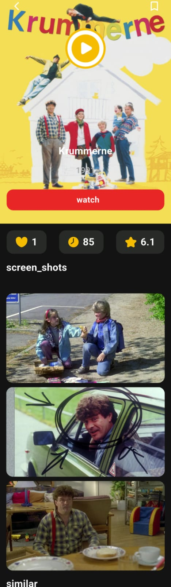
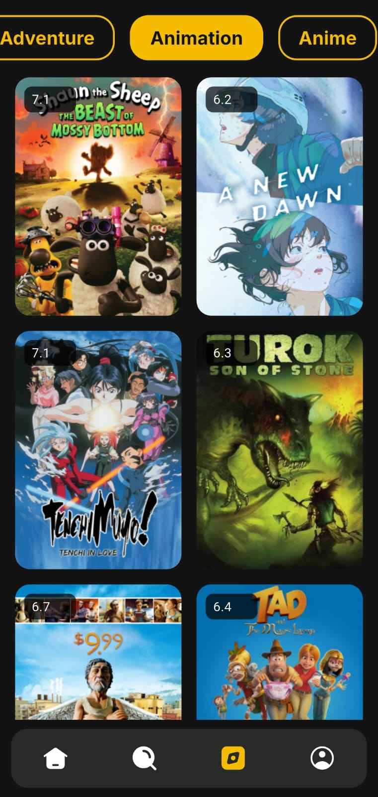
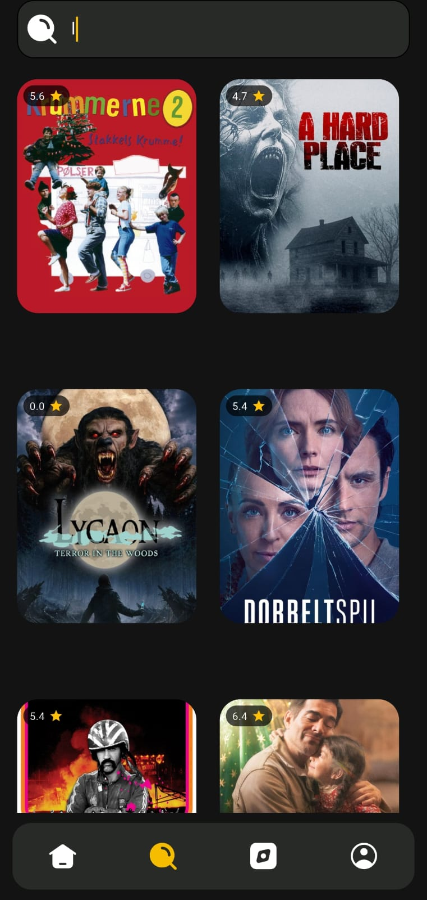
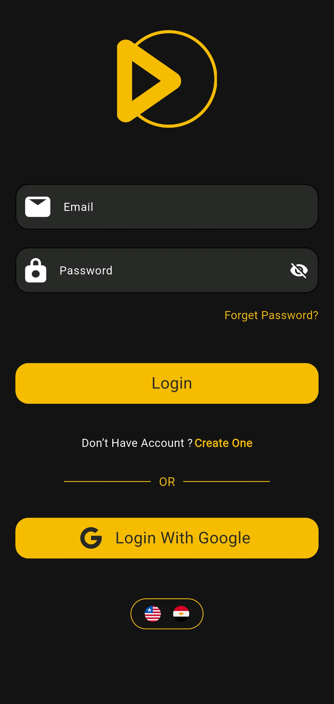
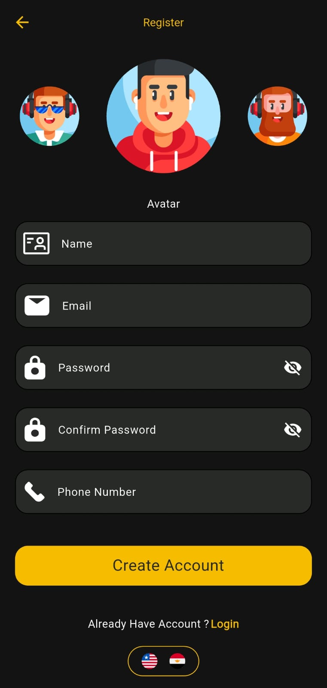
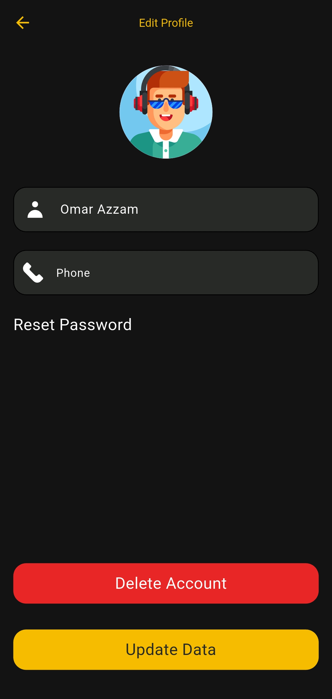
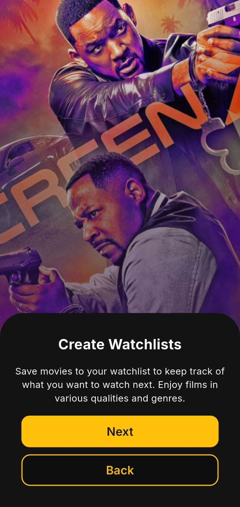

# 🎬 Movies App

A feature-rich Flutter application that allows users to explore movies, discover detailed movie information, search for their favorite titles, and manage a personal watchlist.
Built with Flutter and Dart, using BLoC/Cubit for state management, Dio for API integration, and Firebase for authentication and cloud data storage.

---

## 📱 Screenshots

### 🖥️ Main Screens

| Home Screen | Movie Details |
| :---: | :---: |
|  |  |

| Browse / Categories | Search Screen |
| :---: | :---: |
|  |  |

---

### 🔐 Authentication & Profile

| Login Screen | Register Screen | Edit Profile |
| :---: | :---: | :---: |
|  |  |  |

---

### 🚀 Onboarding Flow

| Step 1 | Step 2 | Step 3 |
| :---: | :---: | :---: |
|  |  |  |

---

## ✨ Features

### 🎥 Movie Discovery
- Browse and explore movies.
- Discover movies through different categories.
- View detailed information about each movie.
- Explore movie ratings and other available details.
- Search for movies by title.

### 🔐 Authentication
- User authentication using Firebase Authentication.
- Sign in with Google.
- User registration and login.

### ❤️ Watchlist Management
- Add movies to your personal watchlist.
- Keep track of movies you want to watch.
- Store watchlist data using Cloud Firestore.
- Access your saved movies.

### ⚡ Performance & User Experience
- Efficient state management using BLoC/Cubit.
- API integration using Dio.
- Cached network images for improved image-loading performance.
- Organized and maintainable Flutter code.

---

## 🛠️ Tech Stack

| Technology | Purpose |
| :--- | :--- |
| **Flutter** | Cross-platform mobile development |
| **Dart** | Programming language |
| **BLoC / Cubit** | State management |
| **Dio** | REST API integration |
| **Firebase Authentication** | User authentication |
| **Google Sign-In** | Google account authentication |
| **Cloud Firestore** | Cloud data storage |
| **Cached Network Image** | Image caching and loading |
| **Easy Localization** | Localization package dependency |

---

## 🏗️ Architecture & Code Organization

The application uses BLoC/Cubit to manage application state and separate UI interactions from business logic.
This approach helps make the code more organized, maintainable, and easier to extend.

Key architectural concepts include:
- **Presentation Layer:** Screens and reusable UI components.
- **State Management:** BLoC/Cubit for handling events, states, and UI updates.
- **Data Layer:** API communication and Firebase data operations.
- **Models:** Structured representation of movie and application data.

---

## 🚀 Getting Started

Follow these steps to run the project locally.

### Prerequisites
Make sure you have the following installed:
- Flutter SDK
- Dart SDK
- Android Studio or Visual Studio Code
- A Firebase project
- A valid movie API key


## 👥 Contributors

This project was developed collaboratively by:

### 1. Omar Azzam
Flutter Developer

- GitHub: [@omarazzam25](https://github.com/omarazzam25)
- LinkedIn: [Omar Azzam](https://www.linkedin.com/in/omar-azzam-1903ab220/)

### 2. Abdullah Nassar
Flutter Developer

- GitHub: [@abdullahnassar2024-pixel](https://github.com/abdullahnassar2024-pixel)

---

**Built collaboratively with Flutter ❤️**

### 1. Clone the Repository
```bash
git clone [https://github.com/omarazzam25/movies_app.git](https://github.com/omarazzam25/movies_app.git)

